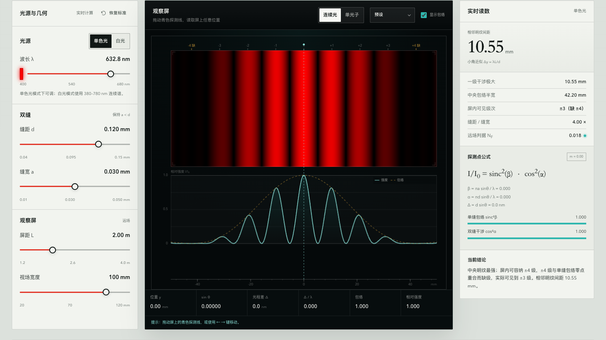
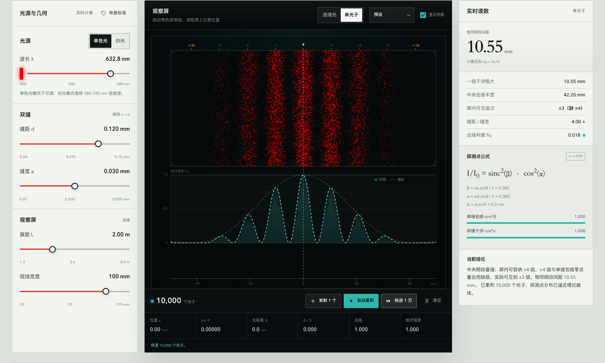

# 双缝干涉实验 · 虚拟光学台

一个零依赖、可离线打开的交互式杨氏双缝虚拟实验。它把同一组夫琅禾费公式连续映射到屏幕条纹、实时读数、实验记录和单光子探测点上，而不是分别做几段互不相干的动画。





## 快速开始

直接双击 `index.html` 即可。若浏览器对本地文件有限制，可在项目目录运行：

```bash
python3 -m http.server 4173
# 打开 http://127.0.0.1:4173
```

运行物理引擎测试：

```bash
node tests/physics.test.js
# 或 npm test
```

## 能做什么

- **单色相干光**：实时改变波长 λ、缝距 d、缝宽 a、屏距 L 和视场宽度，观察双缝干涉因子与单缝衍射包络的乘积。
- **精确几何映射**：屏幕坐标使用 `y = L tanθ`、`sinθ = y/√(y²+L²)`，不是把 `sinθ` 近似成 `θ`。
- **缺级**：当 `m·a/d` 为整数时，第 m 级干涉极大与单缝包络零点重合，界面会标出缺级。中央 `m = 0` 永远不会被标成缺级。
- **白光**：6500 K 黑体连续谱经 CIE 1931 2° 观察者转换；中央零级为白色，高级次展开成彩色。连续光按视亮度显示，单光子按光子通量抽样。
- **单光子累积**：每个探测点独立从归一化强度分布 `I(y)` 抽样（Born 规则）；支持逐个发射、自动累积、快进 1 万和清空。少量光子是随机点，计数增加后逐渐显出理论曲线。
- **可拖动探测线**：读取任意位置的 y、sinθ、光程差 Δ、Δ/λ、包络、相对强度；支持键盘方向键、Home、PageUp/PageDown。
- **实验记录**：把当前参数与理论读数存入浏览器本机，支持删除、清空、导出记录 CSV 和当前强度曲线 CSV。
- **物理边界**：实时显示全孔径菲涅耳数 `N_F = (d+a)²/(λL)`，当前参数范围保证 `N_F ≤ 0.09`，夫琅禾费远场近似成立。

## 物理模型

### 1. 单色相干光

波长为 λ 的相干平面波垂直照明两条等宽、等强、相距 d 的狭缝。远场屏幕上：

```text
E(θ) ∝ sinc(πa sinθ / λ) · cos(πd sinθ / λ)

I(θ)/I₀ = sinc²(πa sinθ / λ) · cos²(πd sinθ / λ)
```

其中：

```text
β = πa sinθ / λ       单缝衍射因子
α = πd sinθ / λ       双缝干涉因子
I/I₀ = sinc²(β) · cos²(α)
```

`sinc(x) = sin(x)/x`，在 `x = 0` 处取 1。中心 `y = 0` 的强度归一化为 1。

### 2. 屏幕几何

屏幕上的位置 y 与角度 θ 的关系使用精确几何：

```text
y = L tanθ
sinθ = y / √(y² + L²)
```

条纹间距的小角近似为：

```text
Δy ≈ λL/d
```

界面同时给出小角近似的 `Δy` 和精确的一级干涉极大位置。注意：由于单缝包络的倾斜，实际强度峰会比“纯干涉极大”略微向中心偏移；界面标注的是干涉极大的位置。

### 3. 缺级

第 m 级干涉极大位于 `d sinθ = mλ`。单缝零点位于 `a sinθ = nλ`。两者重合时：

```text
m · a / d = n        （n 为整数）
```

此时第 m 级缺级。例如默认 `d/a = 4` 时，±4 级缺级；`d/a = 1.5` 时，±3 级缺级。若 `d/a` 只是接近整数而不是严格整数，该级次光强会很低，但不会被标成严格缺级。

### 4. 远场判据

双缝的完整孔径宽度是 `d + a`。界面使用保守的全孔径菲涅耳数：

```text
N_F = (d + a)² / (λL)
```

当前参数范围的最坏情况约为 `N_F = 0.083`，界面显示 `N_F ≤ 0.09`。这保证夫琅禾费近似成立；超出该范围应改用菲涅耳衍射。

### 5. 白光

白光按 380–780 nm、5 nm 间隔的 6500 K 黑体谱做非相干叠加。白光模式没有单一 λ，界面按最短波长 400 nm 保守计算并显示 N_F：

```text
I(y) = Σ S(λ) · I(y; λ)
```

颜色通过 CIE 1931 2° 观察者（Wyman–Sloan–Shirley 解析拟合）转为 XYZ，再转为 sRGB，并按中央明纹做白平衡。连续光模式显示视亮度 `Y/Y_center`；单光子模式按光子通量权重 `λBλ` 抽样，因此两种模式的分布会有细微但物理上合理的差异。

> 显示端无法完整表示光谱色，单色光的 sRGB 颜色被限制在 400–680 nm 的显示近似；白光的积分仍使用完整 380–780 nm 光谱。

### 6. 单光子

单色光：从 `I(y)/∫I(y)dy` 的逆累积分布抽样 y。

白光：联合分布为 `p(λ, y) ∝ w_photon(λ) · I(y | λ)`。先按 `w_photon(λ) · Z(λ)` 抽样波长（`Z(λ) = ∫I(y|λ)dy`），再从 `I(y|λ)/Z(λ)` 抽样位置。这样得到的边际分布严格等于 `Σ w_photon(λ) I(y|λ)`。

每个探测点的竖直位置在照明区域内均匀随机；忽略暗计数、死时间和探测器效率。

## 参数范围

| 参数 | 范围 | 说明 |
| --- | --- | --- |
| 波长 λ | 400–680 nm | 单色光模式可调；白光使用 380–780 nm |
| 缝距 d | 0.04–0.15 mm | |
| 缝宽 a | 0.01–0.05 mm | 自动限制 `a < d`，保持两缝分离 |
| 屏距 L | 1.2–4.0 m | |
| 视场宽度 | 20–120 mm | 屏幕物理视场 |
| 远场判据 | `N_F ≤ 0.09` | 全孔径 `(d+a)²/(λL)` |

默认值：`λ = 632.8 nm`、`d = 0.120 mm`、`a = 0.030 mm`、`L = 2.00 m`、视场 100 mm。默认条件下：

- 相邻明纹间距 `Δy ≈ 10.55 mm`
- 一级干涉极大 `y₁ ≈ 10.55 mm`
- 中央包络半宽 `y ≈ 42.20 mm`
- 屏内可容纳 ±4 级，其中 ±4 级缺级，实际可见到 ±3 级
- `N_F ≈ 0.018`

## 交互说明

- **拖动青色探测线**：读取屏幕任意位置；探测线同时穿过条纹区和强度曲线。
- **键盘**：画布聚焦后，←/→ 每次移动 0.5 mm，Shift + ←/→ 每次 5 mm，Home 回到中心，PageUp/PageDown 移动视场的 1/10。
- **光源**：单色光 / 白光。
- **探测方式**：连续光 / 单光子。
- **显示包络**：在强度曲线中叠加单缝包络 `sinc²β`；白光模式隐藏。
- **预设**：氦氖激光、绿光、缺级演示、密条纹。
- **恢复标准**：顶部和参数面板均可恢复默认值；不会清空实验记录。

## 数据导出

- **导出记录 CSV**：每组记录的参数、条纹间距、包络半宽、可见级次、远场 N_F。
- **导出强度曲线 CSV**：1201 个采样点，包含 `y_mm`、`sin_theta`、`I_norm`、`detection_prob`、`luminance`、`envelope`、`interference`、`path_diff_nm` 以及白光的线性 RGB。
- 记录保存在 `localStorage`，刷新页面后仍在；清除浏览器站点数据会删除记录。

## 测试

`tests/physics.test.js` 覆盖 29 项检查，包括：

- 中心归一化、对称性、干涉极小/极大、单缝零点
- 精确几何 `sinθ = y/√(y²+L²)`
- 条纹间距与一级位置
- 整数比与有理比缺级、近整数比不误标缺级
- 全孔径菲涅耳数与参数归一化
- CIE 白点、光谱色主色、白光中心白平衡
- 单色 CDF 的波长依赖、光子采样分布
- 白光光子边际分布与光子通量探测概率一致
- 非有限/空参数回退、光谱色 400/680 nm 端点、全参数网格 N_F、曲线导出长度
- 白光光子波长边际与光子通量权重一致

```bash
node tests/physics.test.js
# 29 tests passed
```

浏览器端另外通过 Playwright 检查了：桌面/平板/手机布局无横向溢出、探测线映射、模式切换、单光子累积、记录持久化、CSV 下载、键盘操作；axe-core 在单色、白光、单光子和 320 px 视口下均无 WCAG A/AA 违规。

## 文件结构

```text
double-slit-lab/
├── index.html              页面结构
├── styles.css              光学仪器风格与响应式布局
├── js/
│   ├── physics.js          物理引擎（浏览器 + Node 共用）
│   └── app.js              交互、Canvas 绘制、记录与导出
├── tests/
│   └── physics.test.js     29 项物理与数值测试
├── preview-desktop.png     默认图样预览
├── preview-photon.png      单光子累积预览
├── package.json
└── README.md
```

## 已知限制

- 使用理想标量衍射：忽略偏振、缝壁近场耦合、有限缝高和倾斜因子。
- 只实现夫琅禾费远场；不做菲涅耳近场数值传播。
- 屏幕亮度是相对强度，不表示绝对辐照度；显示端做 sRGB 编码。
- 白光使用 5 nm 光谱采样与 6500 K 黑体谱；颜色是显示近似，不是光谱仪读数。
- 单色光谱色在 sRGB 中不可完整表示，显示端限制到 400–680 nm 的近似色。
- 白光离轴颜色可能触及 sRGB 色域边界并发生硬裁剪；这是显示映射限制，不影响强度/位置计算。
- 单光子模型忽略暗计数、死时间、探测器效率和背景光。
- 记录保存在本机 `localStorage`，不是服务器数据库。

## 参考

- Wyman, C., Sloan, P.-P., & Shirley, P. (2013). *Simple Analytic Approximations to the CIE XYZ Color Matching Functions*. Journal of Computer Graphics Techniques, 2(2).
- CIE 1931 2° Standard Observer / sRGB 色彩空间。
- 杨氏双缝与夫琅禾费衍射的标准标量衍射模型。
